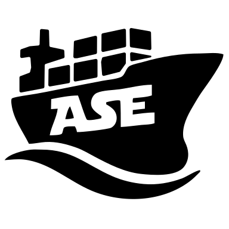
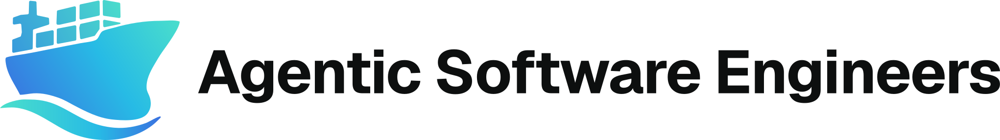
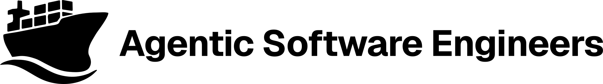

<p align="center">
  
</p>

<h1 align="center">Artwork</h1>

<p align="center">The logos, icons and colours of Agentic Software Engineers, rendered from SVG masters.</p>

## Brand

| | |
| --- | --- |
| **Name** | Agentic Software Engineers (ASE) |
| **Promise** | Fail fast. Fix faster. Ship fastest. Secure. |
| **Belief** | "AI will not be the death of good engineering. It is the golden era of agentic software engineers." ([o3s](https://github.com/agentic-software-engineers/o3s#readme)) |
| **Stance** | "If you are not willing to trade security for productivity, o3s is a match." ([o3s](https://github.com/agentic-software-engineers/o3s#readme)) |
| **Who** | Pioneers of agentic software engineering, working for the community. |
| **Products** | [o3s](https://github.com/agentic-software-engineers/o3s) · [Dev Container Features](https://github.com/agentic-software-engineers/devcontainer-features) |
| **Web** | [agentic-software-engineers.com](https://agentic-software-engineers.com) |

## Logos

Every logo comes in three layouts, each as SVG and as PNG. The **full** logo carries the name on the hull, the **mark** is the ship alone for small sizes and icons, and the **lockup** sets the mark beside or above the name.

| | Color | Color, white text | White | Black |
| --- | :---: | :---: | :---: | :---: |
| Full |  | |  |  |
| Mark |  | |  |  |
| Lockup, horizontal |  |  |  |  |
| Lockup, stacked |  |  |  |  |

Use the **full** logo from 64 px up, and the **mark** below that, where the letters on the hull no longer read. Use **color** on light backgrounds, **color, white text** on Harbor Night, and **white** or **black** where only one colour prints. Keep a clear space around every logo of a quarter of its height, and keep the logos as they are: the same colours, proportions and parts.

## Icons

| File | Size | Use |
| --- | --- | --- |
| [`icons/favicon.ico`](icons/favicon.ico) | 16 + 32 px | Browser tab |
| [`icons/icon-192.png`](icons/icon-192.png), [`icon-512.png`](icons/icon-512.png) | 192, 512 px | Web app manifest |
| [`icons/apple-icon.png`](icons/apple-icon.png) | 180 px | iOS home screen, on Harbor Night |
| [`icons/og-image.png`](icons/og-image.png) | 1200 × 630 px | Link previews |

## Colours

The teal, cyan and blue are sampled from the logo. [`colors/tokens.css`](colors/tokens.css) and [`colors/tokens.json`](colors/tokens.json) hold them for code.

| Name | Hex | Use |
| --- | --- | --- |
| Harbor Night | `#0D0F0F` | Background |
| Signal Teal | `#4BDFCB` | Accent, start of the tide gradient |
| Current Cyan | `#27BBE5` | Accent, middle of the tide gradient |
| Ocean Blue | `#3798DC` | End of the cargo gradient |
| Deep Ocean | `#3B6FE0` | End of the tide gradient |
| Foam | `#F5FAFA` | Text on Harbor Night, light background |

## Type

[Geist](https://github.com/vercel/geist-font), Bold for the name in the lockups, ExtraBold Italic for headlines, Regular for text, and Geist Mono for code.

## Exports

The SVGs in `logo/` and `icons/` are the masters. [`scripts/export.sh`](scripts/export.sh) renders every PNG and the favicon from them with a pinned, checksum-verified [VectorCraft](https://github.com/storytold/vectorcraft), in a container without network. It needs Docker, curl and Python 3.

```sh
./scripts/export.sh
```

The output is the same on every run, and a check on every pull request renders the masters again and fails when a committed file differs.

## License

The artwork is available under the [MIT License](LICENSE). Use the logos to refer to Agentic Software Engineers and its products, and in a way that does not suggest an endorsement.
