

  

<h1 align="center">Artwork</h1>

The logos, icons and colours of Agentic Software Engineers.

## Logos

The logo comes in four layouts, each in up to four versions, as PNG and SVG. The **horizontal** and **stacked** layouts set the name beside or below the ship, the **icon** is the ship alone, and the **full** logo carries the name on the hull. Use **color** on light backgrounds, **color, white text** on dark ones, and **white** or **black** where only one colour prints.

<table>
    <tr>
        <th></th>
        <th colspan="4">PNG</th>
        <th colspan="4">SVG</th>
    </tr>
    <tr>
        <th></th>
        <th>horizontal</th>
        <th>stacked</th>
        <th>icon</th>
        <th>full</th>
        <th>horizontal</th>
        <th>stacked</th>
        <th>icon</th>
        <th>full</th>
    </tr>
    <tr>
        <th>color</th>
        <td></td>
        <td><a href="logo/lockup/stacked/color.png">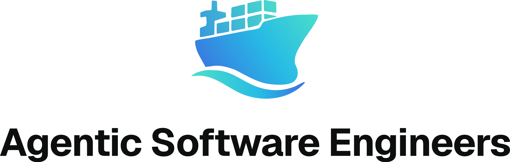</a></td>
        <td><a href="logo/mark/color.png">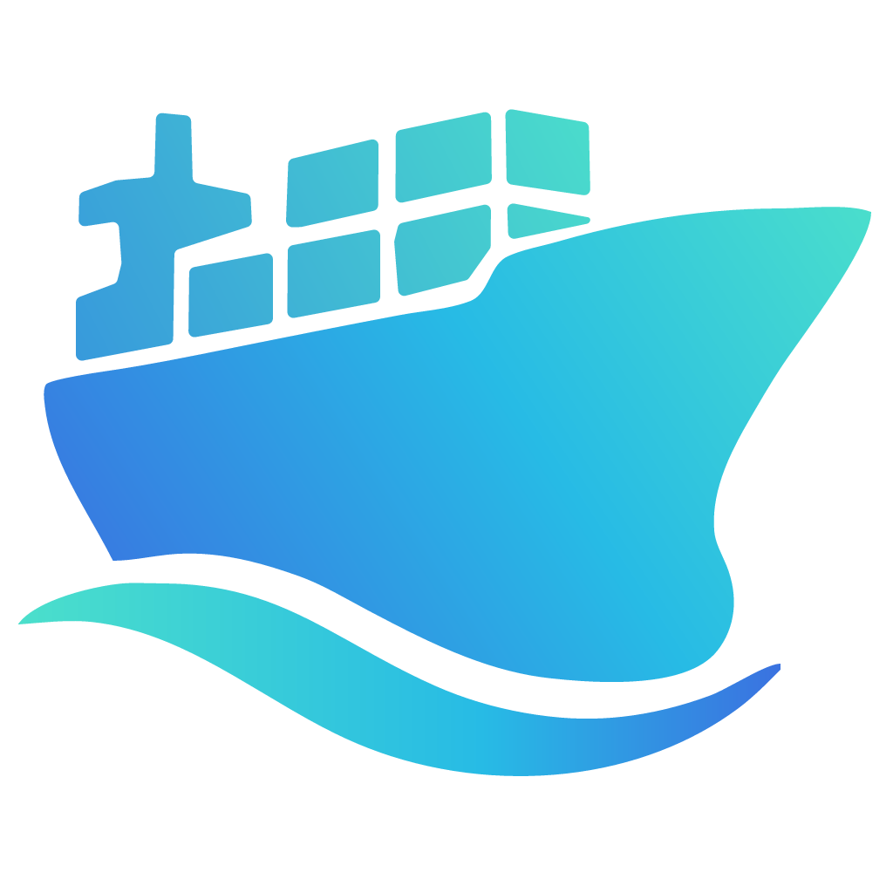</a></td>
        <td><a href="logo/full/color.png">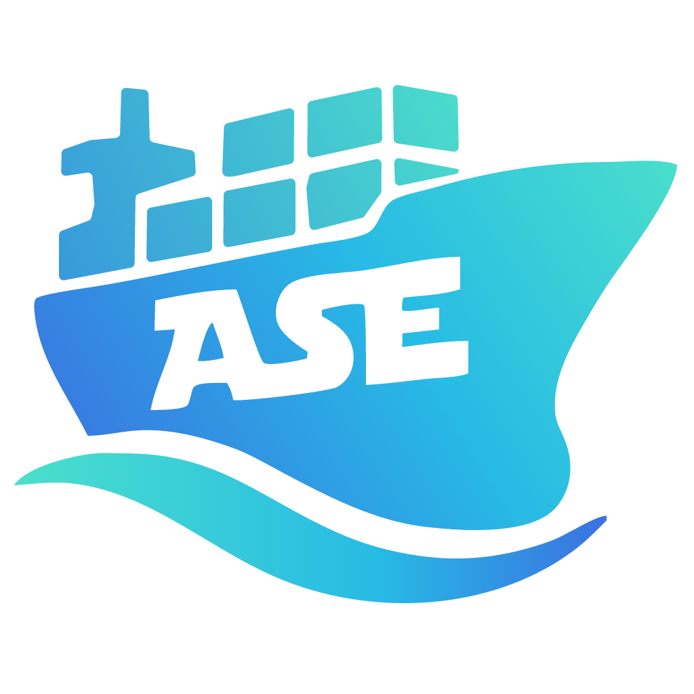</a></td>
        <td></td>
        <td><a href="logo/lockup/stacked/color.svg">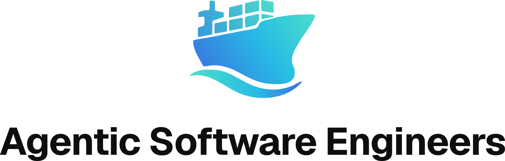</a></td>
        <td></td>
        <td></td>
    </tr>
    <tr>
        <th>color, white text</th>
        <td><a href="logo/lockup/horizontal/color-white-text.png"></a></td>
        <td><a href="logo/lockup/stacked/color-white-text.png">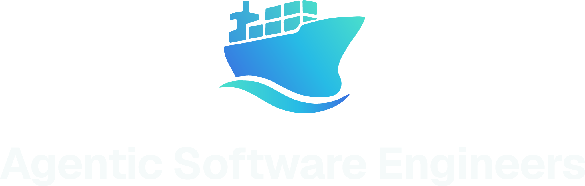</a></td>
        <td></td>
        <td></td>
        <td></td>
        <td></td>
        <td></td>
        <td></td>
    </tr>
    <tr>
        <th>white</th>
        <td></td>
        <td></td>
        <td><a href="logo/mark/white.png"></a></td>
        <td></td>
        <td></td>
        <td></td>
        <td></td>
        <td></td>
    </tr>
    <tr>
        <th>black</th>
        <td></td>
        <td></td>
        <td></td>
        <td></td>
        <td></td>
        <td></td>
        <td></td>
        <td></td>
    </tr>
</table>

## Parts

| | Color | White | Black |
| --- | :---: | :---: | :---: |
| Ship | 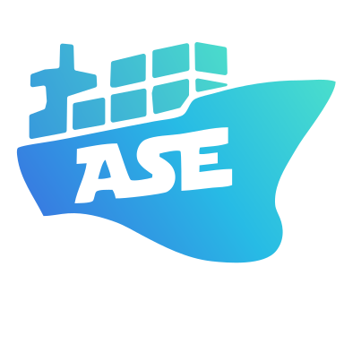 |  |  |
| Wave |  |  |  |
| Hull | 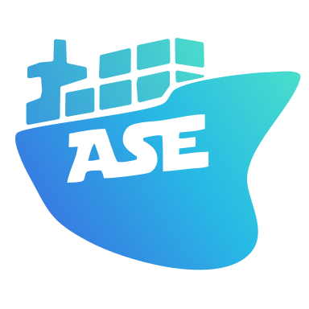 |  |  |

## Icons

| File | Size | Use |
| --- | --- | --- |
| [`icons/favicon.ico`](icons/favicon.ico) | 16 + 32 px | Browser tab |
| [`icons/icon-192.png`](icons/icon-192.png), [`icon-512.png`](icons/icon-512.png) | 192, 512 px | Web app manifest |
| [`icons/apple-icon.png`](icons/apple-icon.png) | 180 px | iOS home screen, on Harbor Night |
| [`icons/og-image.png`](icons/og-image.png) | 1200 × 630 px | Link previews |

## Colours

The teal, cyan and blue are sampled from the logo. [`colors/tokens.css`](colors/tokens.css) and [`colors/tokens.json`](colors/tokens.json) hold them for code.

| Name | Hex | Use |
| --- | --- | --- |
| Harbor Night | `#0D0F0F` | Background |
| Signal Teal | `#4BDFCB` | Accent, start of the tide gradient |
| Current Cyan | `#27BBE5` | Accent, middle of the tide gradient |
| Ocean Blue | `#3798DC` | End of the cargo gradient |
| Deep Ocean | `#3B6FE0` | End of the tide gradient |
| Foam | `#F5FAFA` | Text on Harbor Night, light background |

## License

The artwork is available under the [MIT License](LICENSE). Use the logos to refer to Agentic Software Engineers and its products, and in a way that does not suggest an endorsement.
